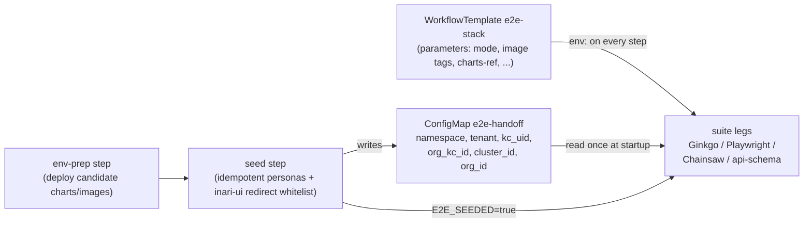

# E2E environment contract

**Status:** normative target for the e2e migration (approved architecture plan
§3.2 — "single source of truth"). Documents **both** the target contract the
migration implements *and* the current kind-era contract it replaces, so every
phase can see the from/to. No suite code changes until the phases that own
them (see "Rollout" at the bottom).

This contract is the set of environment variables the e2e platform injects
into every test leg and every suite consumes. It exists so that:

- a suite never has to know *how* the environment was brought up (Argo
  workflow, local kind, or a long-lived env), only *where* it is;
- one variable set serves all suites (Ginkgo stack suite, Playwright UI suite,
  Chainsaw assertions, api-schema driver, persona seed) — no per-suite
  dialects;
- the release gate, nightly, weekly and PostSync smoke runs differ **only in
  parameters**, never in the contract.

---

## 1. Target contract (live environment)

All variables are injected by the WorkflowTemplate `e2e-stack`
(`gitops/e2e/argo-workflows/workflowtemplate-e2e-stack.yaml`) into every suite
step. Suites read them through one shared module per language — Go:
`scripts/e2e/stack/suite/env.go`; TypeScript: `scripts/e2e/ui/helpers/env.ts`;
Chainsaw: test bindings. **Never read a raw `os.Getenv`/`process.env` outside
those modules.**

| Variable | Required | Default | Meaning |
|---|---|---|---|
| `E2E_BASE_DOMAIN` | yes | — | Public base domain of the e2e environment (e.g. `e2e.inari.example.com`). Console UI and the inari-server API are one origin: console at `https://$E2E_BASE_DOMAIN`, API at `https://$E2E_BASE_DOMAIN/api/v1`. Single-origin topology is required — the server sends no CORS headers. |
| `E2E_KC_URL` | yes | — | Keycloak base URL. On real ingress the browser-reachable URL **is** the API-reachable URL — one value serves both the Playwright login redirect and direct-grant token calls, and the kind-era issuer mismatch (§ "Keycloak URL") dissolves. |
| `E2E_KUBECONFIG` | yes | — | Path to a namespace-scoped, least-privilege kubeconfig for cluster-level assertions (Chainsaw, Go suite kubectl execs). Minted per run by the workflow from the runner ServiceAccount; never a long-lived credential in GitHub. |
| `E2E_USER` / `E2E_PASSWORD` | yes | `dev-admin` / `dev-admin` | The dev-admin persona. Fixed; suites must never mutate it. See "Personas" below. |
| `E2E_TENANT_NAME` | no | `E2E Org` | Display name of the default seeded tenant (the tenant card the smoke spec clicks). |
| `E2E_TENANT_SLUG` | no | `e2e-org` | Slug of the default seeded tenant, used in API paths. |
| `E2E_SEEDED` | injected | `true` | Set to `"true"` by the seed step after it completes. Every suite leg fails fast if unset — a run without personas is a setup bug, not a test failure. |
| `E2E_RUN_ID` | yes | — | Unique per workflow run (Argo workflow UID). Feeds the Playwright `uniqueName()` factories (replacing today's `GITHUB_RUN_ID` fallback) and the janitor CronWorkflow's `e2e-<runId>-*` reaping. |
| `E2E_MODE` | yes | — | `release` \| `edge` \| `nightly` \| `weekly` \| `smoke`. Drives label selection (see [test-taxonomy.md](test-taxonomy.md)) and gate strictness — never suite behavior branches. |
| `E2E_HA` | no | `0` | `1` selects the HA legs (3-node NATS, HA values, disruption specs). |
| `E2E_MIGRATIONS_DIR` | when `E2E_HA=1` | — | Mount of inari-server's `internal/db/migrations` from a `server-src-ref` checkout volume; the HA migration-count assertion fails fast without it. |
| `E2E_GIT_URL` | yes | — | Base URL of the in-cluster git service (replaces the kind hostPath git root + `INARI_GIT_PROVIDER=local` coupling in `git-config.spec.ts`). |

Derived (computed in the shared env modules, overridable only for local
debugging): `API_BASE = https://$E2E_BASE_DOMAIN/api/v1`.

### 1.1 Injection model

- **Run-constant values** (`E2E_BASE_DOMAIN`, `E2E_KC_URL`, `E2E_RUN_ID`, …)
  come straight from workflow parameters / env configuration.
- **Discovered values** (Keycloak user id, org ids, cluster id — today's
  `Handoff` struct fields) are resolved once by the seed step and written to
  the `e2e-handoff` ConfigMap. Suites read that ConfigMap instead of a
  handoff JSON file. On a persistent environment these values are stable
  across runs; the seed re-resolves them after every env-prep because a
  candidate deploy re-imports the Keycloak realm.
- **Secrets** (`E2E_PASSWORD`, kubeconfig content) are mounted from
  cluster secrets (ESO `vault-internal` convention), never passed as workflow
  parameters (they would land in the Argo UI).

### 1.2 Keycloak URL and the issuer constraint

The kind-era suites needed **two** Keycloak addresses: a browser-reachable
one (`KC_HOST` port-forward, helm-upgraded into the console chart's
`keycloakUrl`) and the service-DNS one tokens were issued with; `/etc/hosts`
aliasing glued them together. On the live env both are the same real-ingress
URL, so the contract has exactly one `E2E_KC_URL`. Do not reintroduce a
browser/API split.

### 1.3 Personas (summary — the authoritative table lives in `scripts/e2e/ui/README.md`)

Fixed personas seeded idempotently by the seed step: `dev-admin` (admin,
suite default identity), `e2e-operator`, `e2e-editor`, `e2e-viewer`
(role personas — specs must never change their assignments), and
`e2e-member` (role-less; owned by the role-lifecycle spec, which must
restore it to role-less in `AfterEach`/`afterEach`). Role assignment goes
through the real inari-server membership API — seeding doubles as a
membership-path P0 signal. The seed also owns the `inari-ui` client redirect
whitelist (`https://$E2E_BASE_DOMAIN/*` on the live env), re-added after
every env-prep because the realm re-import wipes it.

### 1.4 Old → new mapping

| Kind-era (current) | Live-env contract | Notes |
|---|---|---|
| `UI_BASE` (ui-proxy `:8080`) | `https://${E2E_BASE_DOMAIN}` | real ingress single origin; `lib/ui-proxy.mjs` deleted |
| `KC_HOST`, `KC_URL` + `/etc/hosts` issuer alias | `E2E_KC_URL` | one URL for browser and API |
| `API_BASE` | `https://${E2E_BASE_DOMAIN}/api/v1` | derived, still overridable |
| `TENANT_NAME` / `TENANT` | `E2E_TENANT_NAME` / `E2E_TENANT_SLUG` | renamed into the `E2E_` prefix |
| `E2E_HANDOFF_PATH` + `Handoff` JSON struct | `e2e-handoff` ConfigMap + contract vars | handoff fields become stable env config; `git_host_dir` / `agent_chart_dir` disappear |
| `SERVER_MIGRATIONS_DIR` | `E2E_MIGRATIONS_DIR` | same content, mounted from a workflow volume |
| `INARI_GIT_PROVIDER=local` + kind hostPath | `E2E_GIT_URL` (in-cluster git service) | `git-config.spec.ts` re-pointed |
| `GITHUB_RUN_ID` (uniqueName seed) | `E2E_RUN_ID` | runner-agnostic |
| `KEEP_CLUSTER`, `E2E_ADOPT_CLUSTER`, `GIT_HOST_DIR`, `HELM_REPOS_SEEDED`, `KIND_NODE_IMAGE`, `E2E_PROVISION_ONLY`, image-tar machinery (`scripts/ci/images.txt`, `normalize-image-tar.py`, kind-config) | **deleted** | kind-era only; the kind path in `provide.go`/`provision.go` stays as a dev-only inner loop but is not part of the CI contract |

---

## 2. Current contract (kind era — migration baseline)

Validated against the code on 2026-10-30. This is what exists **today**; the
target above replaces it phase by phase.

### 2.1 Go stack suite (`scripts/e2e/stack/`, build tag `e2e`)

Resolution in `suite/env.go` (`Load`): if `E2E_HANDOFF_PATH` points at an
**existing** file → attach mode (assert-only, read-only); otherwise
in-process provisioning via `suite/provision.go`, writing the handoff file
when the path is set.

Handoff struct (`suite/env.go` — renames must land in writer and reader):
`namespace`, `toolbox`, `tenant`, `kc_uid` (dev-admin KC user id),
`org_kc_id` (tenant org's Keycloak organization id), `cluster_id`,
`org_id`, `git_host_dir`, `agent_chart_dir`.

| Variable | Default | Meaning |
|---|---|---|
| `E2E_HANDOFF_PATH` | — | attach if the file exists; otherwise provisioning writes it here |
| `E2E_HA` | `0` | `1` flips helm replica values + unlocks disruption subtests |
| `SERVER_MIGRATIONS_DIR` | — | required when `E2E_HA=1` (HA(c) migration-count check) |
| `E2E_PROVISION_ONLY` | — | `1` = bring-up without assertions (local only) |
| `E2E_ADOPT_CLUSTER` + `GIT_HOST_DIR` | — | CI image-preload path: adopt a pre-created kind cluster and fixed git root |
| `KEEP_CLUSTER` | — | `true` keeps kind cluster + git host dir after the run |
| `CLUSTER_NAME` / `NAMESPACE` / `TENANT` / `TOOLBOX_POD` | `inari-e2e` / `inari` / `e2e-org` / `golden-path-tools` | topology |
| `SERVER_IMAGE` / `AGENT_IMAGE` / `CONSOLE_BUNDLE_TAG` | `inari/server:e2e` / `inari/agent:e2e` / `edge` | candidate artifacts |
| `VAULT_DEV_TOKEN` | `e2e-root-token` | dev Vault auth |
| `KIND_NODE_IMAGE` | pinned digest from `stack/testdata/images.txt` | empty = kind default |
| `HELM_CHARTS_DIR`, `PLATFORM_CHART_DIR`, `SERVER_CHART_DIR`, `CONSOLE_CHART_DIR`, `AGENT_CHART_DIR`, `OPERATOR_CHART_DIR`, `OPERATOR_CRDS_CHART_DIR` | repo `charts/` + sibling checkouts | chart sources |
| `HELM_REPOS_SEEDED` | — | `1` skips helm repo add/update (CI helm cache hit) |
| `INARI_E2E_CACHE_BACKEND` | `memory` (`redis` on HA leg) | server cache backend |
| `E2E_AGENT_INPUT_PATH` | — | agent install input override |

Quarantine today: `suite.Quarantined(t, reason)` skips unless run with
`-args -include-quarantined` (nightly only; the gate never sets it). This
mechanism is **retired** by the taxonomy — replaced by
`Label("quarantine")` (see [test-taxonomy.md](test-taxonomy.md)).

### 2.2 Playwright UI suite (`scripts/e2e/ui/`)

`helpers/env.ts` (single-origin through `lib/ui-proxy.mjs`):

| Variable | Default | Meaning |
|---|---|---|
| `UI_BASE` | `http://127.0.0.1:8080` | console entry URL (the ui-proxy, not the console forward) |
| `KC_HOST` | `127.0.0.1:18091` | browser redirect target for KC login |
| `KC_URL` | `http://$KC_HOST` | direct-grant/admin KC calls |
| `KC_REALM` | `inari` | realm |
| `API_BASE` | `$UI_BASE` | inari-server API base |
| `TENANT_NAME` / `TENANT` | `E2E Org` / `e2e-org` | default tenant display name / slug |
| `E2E_USER` / `E2E_PASSWORD` | `dev-admin` / `dev-admin` | default persona (`fixtures/auth.ts`) |
| `GITHUB_RUN_ID` | random hex | `fixtures/org.ts` runId seed for `uniqueName()` |

`lib/ui-proxy.mjs`: `LISTEN_PORT` (8080), `CONSOLE_UPSTREAM`
(`:18080`), `API_UPSTREAM` (`:18090`).

`seed/seed-personas.mjs`: `KC_URL`, `KC_REALM`, `API_URL`
(`http://127.0.0.1:18090/api/v1`), `NAMESPACE` (`inari`), `TENANT`
(`e2e-org`), `UI_ORIGIN` (`http://127.0.0.1:8080` — the redirect-whitelist
origin), `SEED_ADMIN_USER`/`SEED_ADMIN_PASS` (fall back to
`E2E_USER`/`E2E_PASSWORD`), `SEED_KC_ADMIN_CLIENT_SECRET`.

### 2.3 API schema conformance (`scripts/e2e/api/api_schema_e2e_test.go`)

Runs **inside an inari-server checkout** (imports its modules, reads
`dist/openapi.yaml` — run `make export-openapi` first):

| Variable | Default | Meaning |
|---|---|---|
| `E2E_BASE_URL` | — | server base URL (required; test skips if unset) |
| `E2E_KEYCLOAK_URL` | — | KC base URL (required) |
| `E2E_KEYCLOAK_REALM` | `inari` | realm |
| `E2E_CLIENT_ID` | `inari-server` | token client |
| `E2E_USERNAME` / `E2E_PASSWORD` | `dev-admin` / `dev-admin` | user |
| `E2E_ORG` | first `/api/v1/tenants` entry | tenant slug |
| `E2E_OPENAPI` | `../dist/openapi.yaml` | spec path |

### 2.4 kubectl scenarios (`scripts/e2e/kubectl/`)

Docker-compose-style bash chains (no kind): `kubectl-access.sh`
(control-plane only) and `kubectl-tunnel.sh` (gateway chain). Env:
`NETWORK`, `KEEP`, `KC_IMAGE`, `APISERVER_IMAGE`, `ETCD_IMAGE`,
`PG_IMAGE`, `OPENFGA_IMAGE`, `NGINX_IMAGE`, `KUBELOGIN_VERSION`, and
sibling checkouts `INARI_SERVER_DIR` / `INARI_AGENT_DIR` (tunnel builds
`inari/kubeproxy:e2e` + `inari/agent:e2e` from source). These stay
docker-only in GHA and are **not** part of the Argo contract.

### 2.5 Flake tooling

`ui/quarantine-issues.mjs`: `GITHUB_REPOSITORY`, `GITHUB_TOKEN`/`GH_TOKEN`
(stays in GHA — needs `issues:write`, no cluster).

---

## 3. Invariants (apply in both eras — do not regress)

1. **Personas are fixed; spec objects are unique.** Only the role-lifecycle
   spec mutates `e2e-member`, and it must restore it role-less. Spec-created
   objects use the unique-name factory seeded with `E2E_RUN_ID`.
2. **The seed owns the `inari-ui` redirect whitelist** and re-adds it after
   every env-prep; it fails the run fast if the membership API misbehaves
   (P0 signal).
3. **Single-origin topology is required** — the server sends no CORS
   headers; console and API are one origin (`E2E_BASE_DOMAIN`).
4. **Suites fail fast when `E2E_SEEDED` is unset** — never silently run
   against an unseeded env.
5. **The release gate tests exactly the candidate artifact set** (candidate
   charts + image tags, cosign verification ON) — never "whatever is
   deployed."
6. **Tenant specs leak orgs by design** (delete is approval-gated/async) —
   on the long-lived env the janitor CronWorkflow reaps `e2e-<runId>-*`
   leftovers; this is why `E2E_RUN_ID` is part of the contract.
7. **Suite code reads the contract only through the shared env modules** —
   no scattered `os.Getenv`/`process.env`.

## 4. Rollout (which phase owns what)

| Phase | Contract change |
|---|---|
| P0 — foundation | This document is the P0 "env contract documented" exit criterion; env stands up with real ingress (`E2E_BASE_DOMAIN`, `E2E_KC_URL`), git service (`E2E_GIT_URL`), Harbor proxy-cache |
| P1b — Ginkgo restructure | `suite/env.go` reworked to the target contract; attach mode becomes the only CI mode; handoff read from the `e2e-handoff` ConfigMap |
| P1c — de-kind | `helpers/env.ts` re-parameterized; `ui-proxy.mjs` deleted; `git-config.spec.ts` on `E2E_GIT_URL`; seed becomes a workflow step emitting `E2E_SEEDED` |
| P1d — Argo + ReportPortal | WorkflowTemplate injects the full contract; thin GHA wrappers pass parameters only |

Local-dev note: the kind path in `provide.go`/`provision.go` stays as a
dev-only inner loop (open question §9.8 of the architecture plan — default
recommendation: keep). Local runs may keep using the kind-era knobs until
the attach path against the live env is proven; CI never uses them again.
